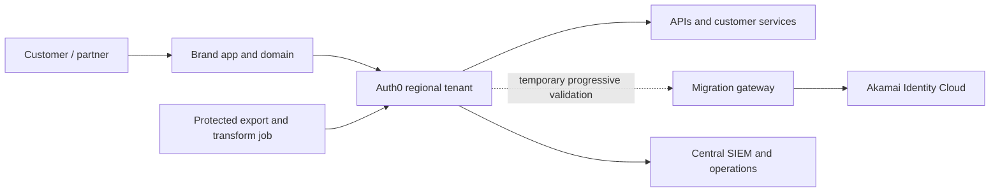

# Akamai Identity Cloud to Auth0 Migration Playbook

This playbook describes how to move customer identity workloads from Akamai Identity Cloud (AIC) to Auth0 with controlled customer impact. It covers profile and credential movement, authentication transition, application and brand cutover, and operational acceptance.

> **Planning context:** Akamai states that Identity Cloud will be decommissioned after **December 31, 2027**. Confirm the current contract, support dates, and export assistance with Akamai before fixing a delivery schedule. See [Akamai End of Life & FAQ](https://techdocs.akamai.com/identity-cloud/docs/product-status).

## Executive decision

Do not assume that AIC passwords must all be reset. Akamai documents export of password hash and algorithm with each user record and says AIC uses bcrypt for normal operation; users whose passwords have never been upgraded to bcrypt may remain. Auth0 documents bulk imports for supported password hashes and automatic migration through a custom database connection. Therefore:

1. Obtain a representative, protected export and classify hash records without exposing passwords or hashes in tickets or logs.
2. Test Auth0 bulk import of AIC bcrypt records in the target plan and tenant before choosing the migration pattern.
3. Use progressive migration only if a secure, supported AIC authentication endpoint remains available for the full transition window and latency, availability, MFA and profile-sync behavior pass a proof of concept (PoC).
4. Treat federation-first as an application cutover bridge. It can defer local password migration only if AIC can remain a working upstream IdP and the selected protocols and account identifiers are validated.
5. Prepare an assisted password reset for unsupported hashes, inaccessible legacy users, and any account that fails the agreed credential migration criteria.

A successful password test is not enough: prove email and phone ownership rules, MFA behavior, duplicate handling, profile mapping, sessions, and rollback before broad release.

## Decision matrix

| Pattern | Credential outcome | Main prerequisites | Benefits | Constraints and suitable use |
| --- | --- | --- | --- | --- |
| **Bulk import with hash** | Customer keeps current password if the exported AIC hash format is accepted by Auth0. AIC documents bcrypt `$2a$10$` examples; Auth0 documents supported bcrypt imports. | AIC export access; exact hash/encoding inventory; Auth0 database connection; mapping and deduplication; secure file staging; PoC against representative hashes. | Fast cutover; no dependency on AIC at login after cutover; supports preloading users by migration wave. | Do not infer every AIC record is bcrypt. AIC warns older accounts that never logged in may have other hashes. Import validation, duplicate identifiers, the 500 KB file-size limit, job limits and upsert semantics need handling. |
| **Progressive / lazy migration** | Customer keeps the entered password. Auth0 checks its store first; for a user not yet imported, a custom database login script validates against AIC. On success Auth0 creates a local user and stores the credential using its own hashing. | AIC authentication API or secured migration service callable from Auth0 scripts; connection/import-mode setup; stable identity key; safe attribute and MFA data returned by the login script; sufficient AIC availability and performance. | Reduces bulk credential-export dependency and migrates active users on demand. Can accommodate legacy hashes because AIC validates them rather than Auth0 importing them. | Requires the legacy service during the transition and does not migrate dormant users. Account/profile creation races, interrupted login, external API timeouts and data-sync drift need controls. Do not delete the AIC user inline after login. |
| **Federation-first transition** | Auth0 redirects to AIC (or another existing IdP); AIC continues to validate the existing credential. Credentials remain in AIC until a later migration or reset. | AIC tenant supports a protocol/Auth0 connection combination proven in the customer environment; callback and logout design; stable subject mapping; enterprise and social IdP ownership. | Moves application protocol and token issuance to Auth0 before moving every credential; useful as a short bridge for a brand or application wave. | Not credential migration. AIC remains a runtime dependency; users can still need reauthentication. AIC availability and EOL timeline constrain the bridge. Validate IdP-initiated flows, MFA claims, account linking, logout, and target-token semantics. |
| **Password reset / re-enrollment** | Auth0 does not receive the legacy password; customer establishes a new Auth0 password through a verified recovery journey. | Verified email/phone or approved assisted recovery; communication, support staffing, rate limits, anti-enumeration controls, accessible localized journeys. | Predictable target state when hashes cannot be exported, imported or safely checked at login. Retires legacy credential dependency quickly. | Adds customer friction and support volume. A reset is not proof of identity by itself; preserve fraud checks and account recovery safeguards. Consider staged prompts and a deadline only with business and risk approval. |

### Credential compatibility: verified facts and open checks

**Documented capability:** Akamai's migration guide describes exporting user profiles through `/entity.find` or Integration Bus, and says the exported record includes the password hash and hash algorithm. It shows AIC bcrypt records as `$2a$10$...`, while warning that accounts that never logged in after an earlier migration could still carry another algorithm.

**Documented Auth0 capability:** Auth0 supports bulk import using its user JSON schema. The profile schema documents bcrypt `$2a$` or `$2b$` hashes with 10 salt rounds. Unsupported hashes require a password reset after import. Auth0 automatic migration instead validates a not-yet-imported user's password against an external store and migrates the supplied password after successful authentication.

**PoC required:** Confirm actual AIC export permission and data shape, hash fields/encoding, Auth0 import acceptance, duplicate behavior, and successful login using multiple real-but-controlled test accounts, including at least one inactive/legacy-hash account if present. AIC's statement that bcrypt is the standard algorithm does not prove every customer tenant has only bcrypt records. Do not transform a hash or change its prefix/cost unless Auth0 confirms the exact import format.

## Target architecture

A practical global pattern separates customer identity from application data and from machine access. Use one tenant per region only where data residency, legal, security, availability, or ownership boundaries require it; otherwise prefer fewer tenants and explicit isolation. A public-cloud tenant's region/locality is selected at creation and is not a freely movable setting. Validate available regions, locality, plan entitlements, and contract requirements with Auth0 before provisioning.

### Tenant, region, and brand boundaries

- Choose region based on the population, contractual residency terms, processing locations, disaster recovery needs, and support model. A tenant's chosen locality should be treated as a provisioning decision; do not assume it can later be changed in place.
- Use separate regional production tenants only when an actual boundary needs them. Keep dev/test tenants aligned with the same schema, Actions, connection settings, log filters, and release process.
- Model brands using Auth0 custom domains and branding configuration when authentication can share a tenant and policy boundary. Use organization context for B2B customers, partner membership, or enterprise-specific connection routing; an Organization is not automatically a brand-isolation boundary.
- Use explicit namespaced brand and customer identifiers in application data. Do not trust a client-supplied brand or organization ID without server-side validation.
- Keep separate Auth0 database connections or tenants only where data isolation, distinct customer populations, regulatory requirements, or operational ownership justify the cost and complexity.

### Federation and account correlation

- For each enterprise, configure and test its SAML or OIDC connection, metadata, signing keys, issuer/subject rules, attribute mapping, organization membership, JIT provisioning, and deprovisioning process.
- Prefer a stable source-system customer/person identifier for correlation. Email is mutable, may be shared, and may be unverified; it is not a safe sole linking key.
- Do not automatically link accounts merely because email addresses match. Require proof of control of both accounts (or an equivalent step-up process), explicit user intent or approved support workflow, and an auditable decision.
- Keep AIC's source ID in a migration ledger and, where appropriate, a protected `app_metadata` attribute. Define a deterministic mapping from `(region, AIC application/entity type, AIC user ID)` to Auth0 `user_id` before import. Ensure no collisions across regions, brands, or connections.
- Decide whether brand identities represent one shared person or distinct legal customer accounts. Linking profiles changes the primary identity and can affect application metadata; test downstream behavior before enabling linking.

### Non-human integration identities

- Inventory AIC API clients, secrets, integrations, scheduled exports, webhooks, and application credentials separately from customer accounts.
- Create least-privilege Auth0 machine-to-machine applications and client grants for APIs and deployment automation. Use confidential storage, rotation, owner assignment, expiry/rotation alarms, and distinct credentials per environment and integration.
- Replace AIC client credentials in consumers through versioned secret rollout. Never copy AIC secrets into Auth0 user records or source control. Validate quotas, retry behavior, webhook signature validation, idempotency, and the service's ability to operate during rollback.

## Implementation sequence

### 1. Discover and classify

Build an inventory for every AIC Capture app, entity type, schema, API client, login policy, OIDC client, flow, social provider, webhook, Integration Bus task, application, API, brand, region, and downstream consumer. Capture owners, traffic, peak rates, contract/EOL constraints, and critical journeys.

Classify accounts by brand, region, entity type, last login, active/disabled/locked state, verified email/phone, duplicate identifiers, local/social/enterprise authentication, MFA state, and password hash type. Use only fields needed for migration and explicitly map each AIC field to an Auth0 root attribute, `user_metadata`, `app_metadata`, or the system that should remain the business source of truth.

Document each application’s current issuer, client identifiers, redirect/logout URLs, scopes, token claims, session duration, refresh-token behavior, and authorization dependencies. Make the downstream APIs accept the new Auth0 issuer and audience before cutover where a dual-issuer period is required.

### 2. Select pattern by population

Use a hybrid decision by cohort rather than forcing one method across all users:

- Bulk import accounts with verified mapping and proven hash compatibility.
- Progressive migration for cohorts whose AIC authentication API and customer journeys pass the PoC and for which the bridge can stay supported through the transition.
- Federation-first for applications/brands where changing application OIDC integration is the first milestone but credential migration is not yet possible.
- Verified password reset for unsupported hashes, unreachable/inactive accounts, risk exceptions, or explicit customer choice.

Record the chosen pattern, reason, population, customer impact, fallback, and owner for each wave.

### 3. Build migration foundations

- Establish regional Auth0 tenants, non-production/prod separation, custom domains, client/API registrations, Organizations if needed, connections, branding, Universal Login, MFA/risk policy, Actions, and log delivery.
- Define schema/versioning rules, immutable correlation keys, deduplication policy, consent and preference semantics, account deletion behavior, retention, and data-controller/processor responsibilities.
- Create a protected export/transform/import pipeline with checksum manifests, record counts, per-wave status, error quarantine, access logging, encryption in transit and at rest, short retention, and deletion verification.
- Use a dedicated least-privilege Management API client for imports. Avoid broad scopes and never log passwords, password hashes, MFA secrets, recovery codes, or bearer tokens.
- For progressive migration, use a private migration gateway with outbound access controls, TLS, request authentication, rate limits, timeouts, circuit breaker, no password persistence, and telemetry that redacts secrets. Verify connection script runtime limits and external network reachability for the specific tenant/plan.

### 4. Prove credentials, identity, and sessions

Prepare an isolated tenant and an AIC test cohort representing every relevant hash type and authentication method. Test bulk import and login in a non-production environment. If import fails for some hash classes, assign those users to reset or progressive migration instead of silently rewriting hashes.

Do not promise session continuity across issuer/domain changes. Browser cookies are scoped to domains, and applications validate issuer, audience, signing keys, and token lifetime. Plan a fresh Auth0 authentication at a controlled point, shorten old-session reliance only with an agreed customer experience, and support both issuers in applications only during an explicit, time-bounded transition. Test mobile app upgrades, deep links, cached tokens, refresh tokens, and logout separately.

### 5. Pilot and sequence waves

Recommended wave order:

1. Internal test identities and non-production applications.
2. Low-risk brand or application with representative web/mobile clients and support coverage.
3. Opt-in or invited pilot customers across regions, including enterprise federation and each MFA method.
4. Active customer cohorts grouped by region, brand, identity method, or application dependency; keep cohort size within measured import, support, and rollback capacity.
5. Remaining users, including dormant/legacy hash accounts through explicit recovery journeys.
6. Long-tail integrations, scheduled exports, and decommissioning.

Within each wave, freeze mappings and configuration, take a consistent source snapshot or record a high-water mark, import a canary batch, reconcile, monitor, then expand by predefined thresholds. Avoid brand cutovers that split a shared customer profile unless identity correlation and cross-brand behavior are proven.

### 6. Cut over and run hypercare

- Publish customer support and recovery guidance in each required locale and brand.
- Change the application authorization server/issuer and callback/logout configuration using a reversible release toggle or deployment strategy.
- Keep AIC and its protected migration/export paths available until all supported rollback and lazy-migration windows close; monitor platform support dates and do not schedule beyond the contracted support period.
- Route logs to the central SIEM, alert on auth errors, legacy fallback rate, unusual account linking, MFA enrollment failure, import job failures, rate limits, latency, and customer-support indicators.
- Run a staffed hypercare period with named identity, application, security, operations, customer support, and vendor owners.

## Data protection and reconciliation

AIC exports may contain password hashes and sensitive profile fields. Treat export files, temporary transform files, import payloads, and migration ledgers as restricted personal data:

- Keep the working copy in an approved region and storage account; encrypt at rest and in transit; use short-lived, named operator access and audit trails.
- Separate source identifiers and status ledger from customer attributes where possible. Use a tokenized/correlated ID in operational dashboards.
- Exclude credential hashes, recovery data, MFA secrets, access tokens, and raw PII from logs, support cases, sample fixtures, and PRs.
- Validate lawful basis, purpose limitation, retention/deletion, data-subject rights, processor/subprocessor terms, residency, and any cross-border transfer before exporting. Compliance depends on the organization's controls and decisions; using Auth0 or this playbook does not certify compliance.
- Retain a migration manifest with counts by region, brand, entity type, hash class, result state, and error category. Reconcile source and target without putting sensitive values in the report.

For each wave, reconcile:

| Control | Reconciliation check |
| --- | --- |
| Population | Eligible source count = imported + excluded with approved reason; no unexplained duplicate/collision. |
| Profile | Required attributes, normalized email/phone, verification state, consent, preferences, disabled/locked state, and entitlements match mapping rules. |
| Credential | Hash class and import result counts agree with the approved cohort plan; sample controlled login succeeds; no credential data appears in logs. |
| MFA | Supported factors import only when valid source secrets/values are lawfully available; otherwise the user is placed in a safe re-enrollment journey. Recovery codes are reissued through the target process. |
| Federation | Each partner connection, issuer, subject correlation, organization membership, and deprovision event is tested. |
| Operations | Import job outcomes, failed-user queue, log coverage, alert delivery, rate limits, support contacts, and rollback evidence are recorded. |

## Rollback and recovery

Rollback is an application and identity decision, not a database restore shortcut. Define which system accepts writes during each stage and how profile, consent, password-reset, MFA, and account-link changes reconcile if traffic returns to AIC.

- Before cutover: stop the wave; preserve source data; correct the mapping or transform; rerun an idempotent batch only after proving duplicate/upsert behavior.
- After cutover: route application login back to AIC only while its service and credentials remain valid; protect accounts created or changed only in Auth0 with a separately tested recovery/synchronization plan.
- For progressive migration, leave AIC records intact during the agreed bridge. Track migrated status separately and do not delete a source identity in the login callback. AIC authentication failures must not silently create a second account.
- Revoke compromised or leaked integration credentials, rotate secrets, invalidate application sessions as needed, and alert customers when required by the incident plan.
- Declare rollback impractical once irreversible customer/profile changes or upstream service retirement occur; use a recovery plan with explicit customer communication and support ownership instead.

## Test scenarios

Run automated and human-reviewed tests for each region, brand, app type, and supported identity method. Record expected result, evidence, and owner.

1. **Hash import:** valid AIC `$2a$10$` bcrypt sample; invalid/corrupt hash; unsupported legacy hash; password case/Unicode behavior; no hash in logs or artifact output.
2. **Progressive validation:** migrated user authenticates locally without AIC call; unmigrated valid user is created once; invalid password fails without account creation; AIC timeout/circuit-breaker behavior; simultaneous logins do not duplicate accounts; interrupted login can recover.
3. **Identity correlation:** duplicate email with distinct AIC IDs; changed email; unverified email; shared family email; same subject across brand/region; social identity and enterprise SAML/OIDC account linking with proof of both accounts.
4. **MFA:** AIC email/SMS 2FA, supported Auth0 email/phone/OTP import only if source values and feature behavior are verified; factor unavailable or phone changed; multiple factors and factor selection; recovery code reissue; step-up for sensitive actions.
5. **Profile and consent:** schema transformation, null/Unicode/long values, consent version/timestamp, marketing opt-out, disabled account, deletion request, profile changes during parallel run, source/target write conflict.
6. **Federation:** SAML and OIDC partner login; expired/rotated signing key; missing/malformed claims; IdP outage; JIT provisioning; deprovisioning; Organization context; SP-initiated and IdP-initiated flows if used.
7. **Brand/region:** correct domain, Universal Login theme, locale, cookie scope, tenant issuer, data-routing, allowed callback/logout URL, cross-brand isolation and shared-profile behavior.
8. **Session and application:** old and new issuer handling, access-token signature/issuer/audience/expiry, refresh-token rotation/revocation, logout, browser cookie, mobile app/deep-link upgrade, API authorization, and stale authorization claims.
9. **Load and resilience:** import throughput and job limits; login peak and rate limits; AIC gateway latency and timeout; Auth0 Actions latency; SIEM delivery lag; retry storm control; regional dependency failure.
10. **Rollback:** switch application configuration to prior issuer; confirm users created only in Auth0 are handled safely; reconcile profile, password, MFA, and consent changes; verify the runbook and escalation tree under timed exercise.

## Operational acceptance criteria

A wave is accepted only when its owner signs off on all of the following:

- 100% of in-scope records are imported, successfully lazy-migrated, or assigned an approved exclusion/recovery state; no unexplained reconciliation variance remains.
- Credential hash types and login success meet the agreed cohort target; unsupported formats route to a verified recovery journey.
- No critical customer journey, authorization boundary, brand separation, regional data control, or enterprise federation test is open.
- Authentication success, failure, MFA, latency, rate limits, Actions, import jobs, and log-stream delivery are observable in dashboards and alerts; security events are searchable in the central SIEM.
- Privacy/security review, access controls, export deletion plan, change approval, support scripts, customer communication, rollback decision, and staffed hypercare are complete.
- Rollback and recovery are demonstrated in a timed rehearsal, and all named service owners accept the residual risks.

## Official references

- [Akamai Identity Cloud Migration Guide](https://techdocs.akamai.com/identity-cloud/docs/migration-guide) — AIC artifacts, hash format, export options, and secure transfer practices.
- [Akamai Identity Cloud End of Life & FAQ](https://techdocs.akamai.com/identity-cloud/docs/product-status) — service timeline and status.
- [Auth0 Custom Database Connections](https://auth0.com/docs/authenticate/database-connections/custom-db) — external authentication and migration connection behavior.
- [Auth0 Automatic Migration](https://auth0.com/docs/manage-users/user-migration/configure-automatic-migration-from-your-database) — import-mode behavior, script requirements, and operational caveats.
- [Auth0 Bulk User Imports](https://auth0.com/docs/manage-users/user-migration/bulk-user-imports) and [user import schema](https://auth0.com/docs/manage-users/user-migration/bulk-user-import-schema) — import process, limits, hash schema, and supported formats.
- [Auth0 MFA Enrollment Import](https://auth0.com/docs/secure/multi-factor-authentication/authenticate-using-ropg-flow-with-mfa/import-user-mfa-authenticator-enrollments) — importable email, phone, and OTP factor data and limitations.
- [Auth0 Account Linking](https://auth0.com/docs/manage-users/user-accounts/user-account-linking) — security requirements and linking behavior.
- [Auth0 Tenant Creation and Regions](https://auth0.com/docs/get-started/auth0-overview/create-tenants) — region and locality behavior.
- [Auth0 Enterprise Identity Providers](https://auth0.com/docs/authenticate/identity-providers/enterprise-identity-providers) and [Organizations](https://auth0.com/docs/manage-users/organizations) — federation and B2B configuration.
- [Auth0 Logs](https://auth0.com/docs/deploy-monitor/logs) and [Deploy CLI](https://auth0.com/docs/deploy-monitor/deploy-cli-tool) — monitoring and tenant configuration delivery.
